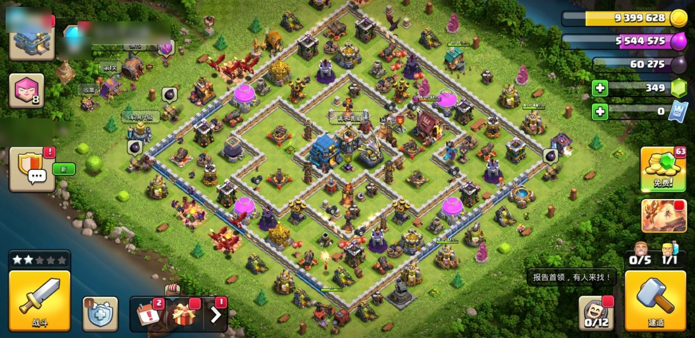
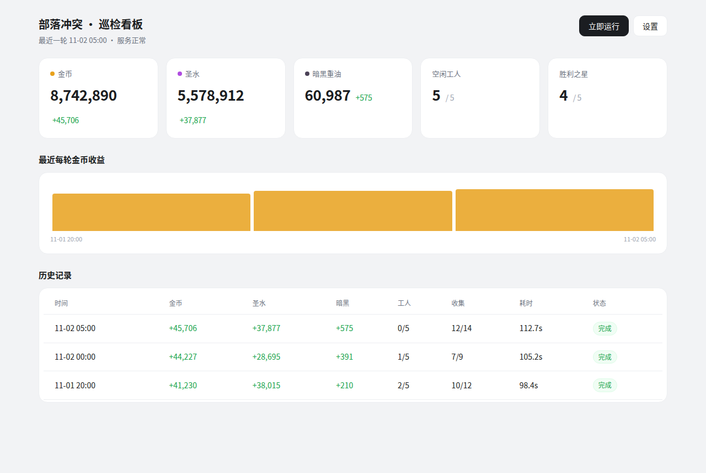
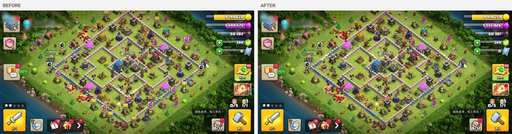

# Clash of Clans Autopilot

部落冲突（Clash of Clans）的村庄自动化：定时收资源、检查工人和胜利之星、按预算自动升级，配一个能看状态、翻历史、对比前后截图的看板。

用真机操作，不碰游戏进程、不读内存、不调接口——所有动作都是普通的点击和截图，跟人手操作一样。

| | |
|---|---|
|  |  |
| 进村后的画面。左上角的账号信息已打码 | 看板首页 |

一轮巡检前后的对比，右边能看出气泡被点掉了、资源涨了：



## 它能做什么

- **收资源**：识别村庄里的金币、圣水、暗黑重油气泡，逐个点开收集，没满的自动跳过
- **巡检**：读右上角三种资源、右下角工人数 `在用/总数`、左下角胜利之星
- **自动升级**：打开右下角「建造」→「建筑和英雄」列表，读出每个可升级项的名字、价格和资源类型，按预算挑一个升掉，用扣款金额校验结果
- **看板**：浏览器里看当前状态、每轮收益趋势、历史记录；点开任意一条能看到开始前/结束后的截图，拖动分割线对比
- **设置**：在页面上改巡检时间、开关收集和升级、限制可花费的资源类型和单次价格上限
- **手动触发**：点一下按钮立刻跑一轮，实时显示进度和日志

## 风险提示

**这可能违反 Supercell 的服务条款。** 游戏禁止使用第三方工具自动化操作，被检测到可能导致封号。作者不对任何账号损失负责。

这个项目刻意避开了两类做法：

- 不读改游戏内存，不注入进程（有内核级反作弊，必被检测）
- 不调用游戏协议接口（资源由服务端裁决，改了也无效）

它只做一件事：用 `adb` 截屏，用 OCR 和模板匹配看懂画面，再用触摸注入点按钮。在服务端看来，这就是一个手速很快的普通玩家。但这不构成安全保证。

## 要求

- **Android 设备**，已开 USB 调试或无线调试，`adb devices` 能看到
- **minicap / minitouch**（可选但强烈建议）：没有它们会退回 `screencap`，一轮从 100 秒变成 6 分钟以上，点击也更容易被游戏丢弃
- **Python 3.9+**
- 设备分辨率 **2220×1080 横屏**（其他分辨率需要改坐标常量，见下文）

## 安装

```bash
git clone https://github.com/<you>/coc-autopilot.git
cd coc-autopilot

python3 -m venv .venv
source .venv/bin/activate
pip install -r requirements.txt

# 必填：你的设备序列号
export ANDROID_SERIAL=1234567890abcdef
```

`ANDROID_SERIAL` 可以写进 shell 配置，也可以每次临时指定。留空会直接报错。

### minicap / minitouch

这两个是 STF 项目的小工具，从设备上抓帧和注入触摸，比 `adb screencap` + `input tap` 快一到两个数量级。

需要把对应设备架构的二进制推到手机并启动：

```bash
# 以 arm64 为例，把 minicap/minicap.so/minitouch 推到 /data/local/tmp
adb push minicap /data/local/tmp/
adb push minicap.so /data/local/tmp/
adb push minitouch /data/local/tmp/
adb shell chmod 755 /data/local/tmp/{minicap,minitouch}
```

脚本会自动启动它们（`mc.py` 用 1313 端口，`mt.py` 用 1111）。没装也能跑，会自动降级。

## 用

```bash
# 跑一轮：进村 → 收资源 → 读数 → 建筑列表巡检 → 有工人且付得起就升一级
python coc_patrol_run.py

# 按配置里的排期跑（配合 cron 每小时叫一次）
python coc_patrol_run.py --if-due

# 看板，默认 8899 端口
python coc_dashboard.py
```

浏览器打开 `http://<你的机器>:8899`。

### 定时任务

```cron
0 * * * * /path/to/.venv/bin/python /path/to/coc_patrol_run.py --if-due >> /tmp/coc_patrol.log 2>&1
```

每小时叫一次，脚本自己按 `config.json` 里的排期（北京时间）判断到点没。这样改排期不用动 crontab，也不受夏令时影响。

### 配置

页面右上角「设置」可以改，也可以直接编辑 `config.json`：

```json
{
  "schedule": ["09:00", "13:00", "18:00", "22:00"],
  "collect": true,
  "upgrade": true,
  "upgrade_kinds": ["gold", "elixir"],
  "max_price": 3000000,
  "max_upgrades": 1,
  "min_free_workers": 1
}
```

| 字段 | 说明 |
|---|---|
| `schedule` | 巡检时刻，北京时间 `HH:MM` |
| `collect` | 是否收资源 |
| `upgrade` | 是否自动升级，关掉就完全不花资源 |
| `upgrade_kinds` | 允许消耗的资源，`dark` 是暗黑重油，默认不开 |
| `max_price` | 单次升级价格上限 |
| `max_upgrades` | 每轮最多升几个 |
| `min_free_workers` | 至少保留几个空闲工人不占用 |

### 数据

每轮在 `history/<时间戳>/` 下存三样东西：

- `before.jpg` — 进村后、开始收集前的截图
- `after.jpg` — 跑完后的截图
- `meta.json` — 前后资源、工人、胜利之星、气泡数、可升级项、实际升级结果

默认保留 30 天，超期自动清理。

## 换个分辨率怎么办

代码里的坐标常量是按 **2220×1080 横屏** 定的，换设备需要重新量。要改的地方都在 `coc_patrol2.py` 顶部：

```python
RES_BANDS = {"gold": (30, 95), "elixir": (100, 175), "dark": (180, 260)}
RES_CROP = (1830, 2160)
WORKER_BOX = (1950, 780, 2075, 880)
STAR_BOX = (50, 798, 205, 866)
BUILD_BTN = (2091, 918)
CONFIRM_BTN = (1534, 947)
```

方法：开一轮巡检，把 `before.jpg` 拉出来，量右上角三行资源、右下角工人计数、左下角五星、右下角锤子、确认弹窗绿色按钮的像素位置，按比例换进去。

## 工作原理

进村流程是个状态机：启动游戏后反复截图 + OCR，认出「欢迎回来」「确认退出」「广告弹层」这些弹窗并处理，直到画面里有村庄该有的东西（建造按钮、资源数字），才算进村成功。

收集靠颜色分型。气泡底色区分资源类型：金币黄、圣水紫、暗黑深紫。点气泡→检测面板是否弹出→有「收集」按钮就点→没有就退出（说明收集器没满，气泡只是「可加速」提示）。

读数字是最麻烦的部分。资源数字是白字压彩色底，直接 OCR 认不准。做法是转 HSV，取「高亮且低饱和」的像素当白字，其余全滤掉，再放大四倍识别；连拍三帧投票，加上数值范围校验兜底。

升级走的是右下角锤子打开的「建筑和英雄」列表——不用在村庄里找建筑，因为找不准。列表里每项的价格右边有个小图标，颜色决定资源类型（黄=金币、紫=圣水、深紫=暗黑），点行→弹确认框→点绿色按钮，最后用扣款金额核对是否真的生效。

## 已知限制

- 坐标绑定分辨率，换设备要重量
- 会漏点：`input tap` 注入的事件游戏大约会丢一半，代码里靠重试兜底，收集命中率大概 60–80%
- 村庄布局会随机刷新（活动建筑、障碍物），所以升级走固定位置的列表，不在村庄里按坐标找建筑
- 不处理战斗、不处理部落、不处理夜世界
- 只验证过国服（腾讯版包名 `com.tencent.tmgp.supercell.clashofclans`），国际服要改包名和 Activity

## 许可

MIT。见 [LICENSE](LICENSE)。

游戏素材（`coc_templates/` 里的模板图）版权归 Supercell 所有，仅作为识别用的最小必要样本。

## 社区

本开源项目已链接并认可 [LINUX DO 社区](https://linux.do)。
