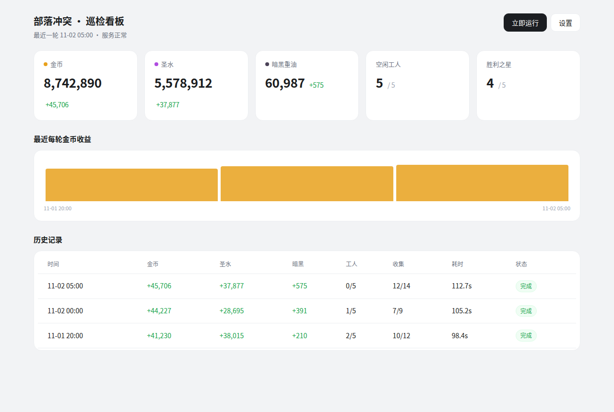

# Clash of Clans Autopilot

部落冲突（Clash of Clans）的村庄自动化：定时收资源、检查工人和胜利之星、按预算自动升级，配一个能看状态、翻历史、对比前后截图的看板。

用真机操作：动作用普通的点击注入，不注入进程、不改游戏数据、不调游戏接口。
数字有两条路可切——**OCR 后端**（默认，截图 + 识别，不需要 root）和 **内存后端**
（root 读 `/proc/<pid>/mem`，逐位精确、地址失效能自愈）。见「[两种后端](#两种后端ocr-与内存)」。

| | |
|---|---|
|  |  |
| 进村后的画面。左上角的账号信息已打码 | 看板首页 |

一轮巡检前后的对比，右边能看出气泡被点掉了、资源涨了：


## 它能做什么

- **收资源**：识别村庄里的金币、圣水、暗黑重油气泡，逐个点开收集，没满的自动跳过
- **巡检**：读右上角三种资源、右下角工人数 `在用/总数`、左下角胜利之星
- **自动升级**：打开右下角「建造」→「建筑和英雄」列表，读出每个可升级项的名字、价格和资源类型，按预算挑一个升掉，用扣款金额校验结果
- **自动研究**（内存后端）：点实验室 →「研究」→ 一页页翻完兵种和法术（圣水 / 暗黑两套都有），挑一个付得起又没超上限的升掉——实验室只有 1 个槽位，正在研究时自动跳过，不碰宝石加速
- **看板**：浏览器里看当前状态、每轮收益趋势、历史记录；点开任意一条能看到开始前/结束后的截图，拖动分割线对比
- **设置**：在页面上改巡检时间、开关收集和升级、限制可花费的资源类型（金币/圣水/暗黑）和**按币种分别设的**单次上限
- **手动触发**：点一下按钮立刻跑一轮，实时显示进度和日志

## 风险提示

**这可能违反 Supercell 的服务条款。** 游戏禁止使用第三方工具自动化操作，被检测到可能导致封号。作者不对任何账号损失负责。

这个项目刻意避开了两类做法：

- 不**写**游戏内存、不注入进程（有反作弊，写内存基本必被检测）
- 不调用游戏协议接口（资源由服务端裁决，改了也无效）

默认的 OCR 后端只做一件事：用 `adb` 截屏，用 OCR 和模板匹配看懂画面，再用触摸注入点按钮。在服务端看来，这就是一个手速很快的普通玩家。

可选的内存后端会**只读**地读游戏进程的内存（`/proc/<pid>/mem`），用来把资源数字和升级扣费看准——读的是游戏自己算出来的计数，不写任何东西。这比 OCR 更准，但自动化痕迹也更重，而且需要手机 root。要不要开，自己权衡。

## 架构

三个进程，职责分开——抓帧只读取、决策只看读数、看板只管展示：

```
┌────────────────┐   minicap(1313)   ┌──────────────────┐
│  Android 设备  │──────────────────▶│ coc_patrol2.py   │
│  CoC（横屏）   │◀──────────────────│ 抓帧 / OCR / 点击 │
└────────────────┘  minitouch(1111)  └────────┬─────────┘
                                              │ 一轮结果
                                              ▼
                                     ┌──────────────────┐
                                     │ history/<时间戳>/ │
                                     │ meta.json        │
                                     │ before/after.jpg │
                                     └────────┬─────────┘
                                              │ 读
                                              ▼
                                     ┌──────────────────┐
                                     │ coc_dashboard.py │
                                     │ :8899 页面 + API │
                                     └──────────────────┘
```

`coc_patrol_run.py` 是编排层：读配置 → 判断到点没 → 调**当前后端**（默认 `coc_patrol2`，
配成内存后端时是 `coc_backend_mem`）跑一轮 → 落盘 → 清理过期记录。两个后端导出同名函数，
编排层只在选后端那一处分叉。
看板只读 `history/`，不碰设备；「立即运行」按钮通过 `subprocess` 拉起巡检进程，靠 `meta.json` 和日志感知进度。

心跳只有一条：cron 每小时叫一次 `--if-due`，脚本自己看北京时间。改排期不用动 crontab。

## 目录结构

```
├── coc_patrol2.py      # OCR 后端：进村状态机、气泡识别、读数、面板守卫、建筑列表升级
├── coc_backend_mem.py  # 内存后端 I/O：常驻 root shell、读 /proc/<pid>/mem、地址失效自愈、镜头标定、按采集点收集
├── coc_mem_buildings.py# 内存后端建筑池：枚举 549 个建筑（类型/等级/坐标）→ 可升级目标 + 价格表 + 点击偏移
├── coc_mem_panel.py    # 内存后端面板识别：锤子定「升级」按钮、标题等级、红白字价格、币种、确认页
├── coc_mem_auto.py     # 内存后端的一轮主循环：数工人、轮换升级目标、三层面板校验、扣费验证
├── coc_mem_research.py # 内存后端的研究流程：点实验室 → 翻页读完全部兵种/法术 → 挑一个 → 确认 → 验扣费
├── collectors_mem.json # 内存后端的 17 个采集点（7 金矿 / 7 圣水 / 3 暗黑钻井）+ dismiss 点
├── building_prices.json# (建筑类型, 等级) → 升级价格，面板实测回填（第一次升级前是空的）
├── research_catalog.json # 研究对象目录（兵种 / 法术 / 攻城机器）：名字、等级、价格、币种，做研究时回填
├── tap_offsets.json    # 建筑类型 → 点击偏移（投影点落在建筑顶棱，往下挪才点得到本体）
├── coc_patrol_run.py   # 一轮巡检的编排 + 落盘 + 历史清理（生产入口，按 config.backend 选后端）
├── coc_dashboard.py    # 看板：页面、API、手动触发、配置读写
├── coc_names.py        # 英文类型名 → 中文（建筑 76 / 兵种 55 / 法术 18），看板只显示中文
├── static/icons/       # 图标（base64 内嵌进页面，零外部请求）：资源 4 张 + 建筑/兵种/法术 102 张
├── tools/icons_fetch.py# 从社区 wiki 抓建筑/兵种/法术立绘 → static/icons/*.png（80×80、透明、≤6KB）
├── coc_config.py       # 配置结构与校验，按北京时间判断是否到点
├── mt.py               # minitouch 封装：坐标换算、tap/press/pinch、断线重连
├── mc.py               # minicap 封装：常驻帧流，失败降级 screencap
├── coc_templates/      # 气泡模板（金币、圣水）+ 数字模板 + 面板锤子 + 村庄锚点图 + 实验室定位图
│                       # （lab_locator 用来在镜头被游戏推到实验室后反解平移量、修真标定）
├── docs/               # 文档截图
├── config.example.json # 配置样例
└── history/            # 运行期产物（不提交）：每轮 meta.json + 前后截图
```

## 要求

- **Android 设备**，已开 USB 调试或无线调试，`adb devices` 能看到
- **minicap / minitouch**（可选但强烈建议）：没有它们会退回 `screencap`，一轮从 100 秒变成 6 分钟以上，点击也更容易被游戏丢弃
- **Python 3.9+**
- 设备分辨率 **2220×1080 横屏**（其他分辨率需要改坐标常量，见下文）
- **（仅内存后端）手机已 root**，`su` 可用（Magisk 之类），并且 `adb shell su -c 'id'` 能直接拿到 uid=0

## 安装

```bash
git clone https://github.com/<you>/coc-autopilot.git
cd coc-autopilot

python3 -m venv .venv
source .venv/bin/activate
pip install -r requirements.txt

# 必填：你的设备序列号
export ANDROID_SERIAL=1234567890abcdef
```

`ANDROID_SERIAL` 可以写进 shell 配置，也可以每次临时指定。留空会直接报错。

### minicap / minitouch

这两个是 STF 项目的小工具，从设备上抓帧和注入触摸，比 `adb screencap` + `input tap` 快一到两个数量级。

需要把对应设备架构的二进制推到手机并启动：

```bash
# 以 arm64 为例，把 minicap/minicap.so/minitouch 推到 /data/local/tmp
adb push minicap /data/local/tmp/
adb push minicap.so /data/local/tmp/
adb push minitouch /data/local/tmp/
adb shell chmod 755 /data/local/tmp/{minicap,minitouch}
```

脚本会自动启动它们（`mc.py` 用 1313 端口，`mt.py` 用 1111）。没装也能跑，会自动降级。

## 用

```bash
# 跑一轮：进村 → 收资源 → 读数 → 建筑列表巡检 → 有工人且付得起就升一级
python coc_patrol_run.py

# 只读不点：读数、气泡（或采集点）、工人星星、建筑列表、升级候选都照跑，但不点气泡不点确认
python coc_patrol_run.py --dry

# 强制用内存后端跑一轮（不看 config 里的 backend）
python coc_patrol_run.py --backend memory

# 内存后端空跑一轮：读数、镜头标定、采集点位、工人、可升级候选都算，一次点击都不发
python coc_patrol_run.py --backend memory --dry

# 按配置里的排期跑（配合 cron 每小时叫一次，只对 OCR 后端有意义）
python coc_patrol_run.py --if-due

# 看板，默认 8899 端口
python coc_dashboard.py
```

浏览器打开 `http://<你的机器>:8899`。

### 定时任务

OCR 后端：每小时叫一次，脚本自己按 `config.json` 里的排期（北京时间）判断到点没。这样改排期不用动 crontab，也不受夏令时影响。

```cron
0 * * * * /path/to/.venv/bin/python /path/to/coc_patrol_run.py --if-due >> /tmp/coc_patrol.log 2>&1
```

内存后端：**一天 4 次**（北京时间 8/12/18/22 点），一轮就是一个「开机—干活—关机」的闭环：
冷启动 → 收资源 → 升级/研究 → 写记录 → 杀游戏 → 锁屏。

```cron
# crontab 写的是系统时区的 19/23/5/9 点（这台机器是 EST，比北京慢 13 小时）= 北京 8/12/18/22
0 19,23,5,9 * * * flock -n /tmp/coc_patrol.lock /path/to/.venv/bin/python /path/to/coc_patrol_run.py --backend memory >> /tmp/coc_patrol_mem.log 2>&1
```

为什么从每 10 分钟改成一天 4 次：挂着不关的话矿满了也不再产出（资源只按离线时间累积），
而冷启动一次能把攒下来的矿一次性收上来（实测一轮 +94 万金币）；代价是每轮要重新定位一次内存地址，
单轮从 50 秒涨到 3~5 分钟。顺带解决屏幕损耗和发热：干完活游戏进程被杀、屏幕锁上，一天只亮 4 次。

`flock -n` 是外层保护：上一轮没跑完就跳过这一轮。**手动跑也安全**——`coc_patrol_run.py`
自己在入口抢同一把锁文件（`/tmp/coc_patrol.lock`），抢不到就打印「另一轮在跑，跳过」并退出 0。
（内部用的是 POSIX 记录锁 `fcntl.lockf` 而不是 `flock`：cron 的外层 `flock` 会把锁 fd 传给子进程，
子进程再 `flock` 同一个文件会自己撞自己，实测会变成每轮都被跳过。）

内存后端必须用装了 `rapidocr-onnxruntime` 的那个解释器（`requirements.txt` 里那套），它仍然复用 OCR 后端的面板守卫/进村逻辑。

### 登录态巡检（`--check-login`）

一轮干完就 `am force-stop` + 锁屏，所以**「游戏没在跑」是常态，不是异常**。
登录检查因此做成项目里的一条独立入口，判据只有一份，别处不再实现第二遍：

```sh
cd /path/to/coc-autopilot
.venv/bin/python coc_patrol_run.py --check-login      # 打一行 JSON，退出码 0=不用管 1=要人看
```

判据：

| 情况 | state | 什么时候报 |
|---|---|---|
| 没进程（游戏关着） | — | **完全不输出**，退出码 0（一天 4 轮巡检，关着才是正常） |
| 巡检正在跑 | `round_running` | 不报。它刚冷启动、正在重定位，这会儿读内存只会错报 |
| 进程在但不在前台 | `not_foreground` | 不报（熄屏或用户切走了，不看画面） |
| 游戏在跑却停在登录/授权页 | `login_page` | **任何时间都报**：说明有人动过手机，得用户本人登 |
| 断线弹窗（还在吗／重新载入） | `reconnect` | 只在「应该跑」的窗口内报 |
| 画面很暗（遮罩） | `dim_overlay` | 只在窗口内报 |
| 没有地址 / 地址失效 / 读不到内存 | `no_state` / `addr_stale` / `memory_unreadable` | 只在窗口内报（冷启动后本来就会失效，下一轮自己会定位） |
| 正常 | `ok` | 不报，但在 JSON 里带上读到的三项资源对账用 |

「应该跑」的窗口 = `login_check_windows`（默认北京 08:00 / 12:00 / 18:00 / 22:00）每个点往后
`login_check_window_min`（默认 30）分钟。**这两个值要和 crontab 里那几次巡检对齐**，改 cron 时一起改。

画面判据不是另写一套 adb：用的是后端同名原语 `screen_kind()`（内存后端 = `village_probe`，
OCR 后端 = `classify`），`pid_of()` 也是同一份实现，所以两种后端下判据一致。
登录页只认具体关键词（`QQ登录` / `微信登录` / `用户协议` / `同意并继续` …），**从不点任何登录按钮**。

定时怎么接（二选一，脚本都只有三行、不含任何判断逻辑）：

```cron
# crontab：每 30 分钟查一次，只有退出码非 0 才输出（= 触发提醒）
*/30 * * * * cd /path/to/coc-autopilot && out=$(/path/to/.venv/bin/python coc_patrol_run.py --check-login 2>&1); [ $? -ne 0 ] && [ -n "$out" ] && printf '%s\n' "$out"
```

```sh
# Hob 的「routine」检查脚本（30 分钟一次）也是同一个入口：
cd /path/to/coc-autopilot || exit 0
out=$(timeout 120 /path/to/.venv/bin/python coc_patrol_run.py --check-login 2>&1)
rc=$?
[ "$rc" -ne 0 ] && [ -n "$out" ] && printf '%s\n' "$out"
exit 0
```

> 早期版本把这套判据写在一个独立小脚本里（`coc_proto/coc_login_guard.py`），已经弃用：
> 它没有时间窗概念、会把「游戏关着」当故障（一天吵 48 次），读的还是另一份旧地址表。文件留作回滚参考，不要再调用。

### 配置

页面右上角「设置」可以改，也可以直接编辑 `config.json`：

```json
{
  "backend": "memory",
  "schedule": ["09:00", "13:00", "18:00", "22:00"],
  "collect": true,
  "upgrade": true,
  "upgrade_kinds": ["gold", "elixir", "dark"],
  "max_price": 3000000,
  "max_upgrades": 1,
  "min_free_workers": 1,

  "max_targets": 5,
  "builders": 5,
  "include_walls": false,
  "include_bb": false,
  "currency": "any",
  "build_max_h": 168,
  "mem_cooldown_h": 24,

  "max_cost_gold": 3000000,
  "max_cost_elixir": 6000000,
  "max_cost_dark": 100000,
  "upgrade_currency_priority": ["elixir", "dark", "gold"],

  "research": true,
  "research_currency_priority": ["elixir", "dark", "gold"],
  "research_alternate": true,
  "research_min_gap_min": 30,
  "research_max_pages": 8,
  "research_max_h": 240
}
```

| 字段 | 说明 |
|---|---|
| `backend` | 读数后端：`ocr`（默认）或 `memory`，见「两种后端」 |
| `schedule` | 巡检时刻，北京时间 `HH:MM`（只对 OCR 后端生效） |
| `collect` | 是否收资源 |
| `upgrade` | 是否自动升级，关掉就完全不花资源 |
| `upgrade_kinds` | 允许消耗的资源（`gold`/`elixir`/`dark`），**宝石永远不在名单里** |
| `max_price` | 单次升级价格上限（老键，跨币种一刀切；内存后端看下面的分币种上限） |
| `max_cost_gold` / `max_cost_elixir` / `max_cost_dark` | 内存后端：**按币种分别设**的单次花费上限，升建筑和研究共用 |
| `upgrade_currency_priority` | 先花哪种资源。圣水满仓会浪费，所以默认 `elixir` 第一；暗黑量少排第二 |
| `max_upgrades` | OCR 后端：每轮最多升几个 |
| `min_free_workers` | OCR 后端：至少保留几个空闲工人不占用 |
| `max_targets` | 内存后端：每轮最多试几个升级目标（实际还受空闲工人数限制） |
| `builders` | 内存后端：工人总数，用来算空闲人数 |
| `include_walls` / `include_bb` | 内存后端：是否升城墙 / 是否含夜世界 |
| `currency` | 内存后端：只升花这种货币的建筑（`gold`/`elixir`/`dark`/`any`） |
| `build_max_h` | 内存后端：施工超过这么多小时还没涨级 = 状态失效，不计入忙碌 |
| `mem_cooldown_h` | 内存后端：同一栋升完之后多少小时不再碰 |
| `research` | 内存后端：是否自动做实验室研究（兵种 / 法术） |
| `research_currency_priority` / `research_alternate` | 研究的币种优先级；`alternate` 打开时「上一笔用过的币种」排到最后，圣水和暗黑轮着消化 |
| `research_min_gap_min` | 实验室空着时最快多少分钟查一次（防止每 10 分钟都去点一遍手机） |
| `research_max_pages` / `research_max_h` | 研究弹窗最多翻几页 / 超过这么多小时没动静就当状态失效 |
| `cold_start` | 每轮先冷启动游戏（唤醒解锁 → 没跑就拉起 → 等进村），默认开 |
| `close_game_after_run` | 记录落盘之后杀掉游戏，默认开（省屏幕、降温度） |
| `lock_screen_after_run` | 关游戏之后锁屏，默认开（下一轮自己唤醒解锁） |
| `village_wait_s` | 冷启动后等进村的上限，默认 120 秒 |
| `locate_stage_s` / `locate_total_s` | 单级重定位 / 整轮重定位的时间上限，默认 180 / 300 秒 |
| `round_max_s` | 一轮的硬上限（看门狗），默认 600 秒；到点也要落盘 + 收尾 |

### 数据

每轮在 `history/<时间戳>/` 下存三样东西：

- `before.jpg` — 进村后、开始收集前的截图
- `after.jpg` — 跑完后的截图
- `meta.json` — 前后资源、工人、胜利之星、气泡数、可升级项、实际升级结果、
  `dur_s`（这一轮真实秒数，同 `duration`）、`gain`、`alerts`、`cold_start`（怎么进的村）、
  `relocate`（定位花了多久、走的哪一级）、`shutdown`（关游戏 / 锁屏的结果）

默认保留 30 天，超期自动清理。

## 两种后端（OCR 与内存）

读数（以及「这一下到底收没收到 / 这一级到底扣没扣钱」的判断）有两条实现，用 `backend` 切换：

| | `backend: "ocr"`（默认） | `backend: "memory"` |
|---|---|---|
| 数字从哪来 | 截屏 → HSV 抠白字 → OCR → 多帧投票 | root 读 `/proc/<pid>/mem`，一次 `dd ~\| od` 约 70ms |
| 精度 | 会把 `6,065,002` 拆成三段拼，滚动时可能认错一位，靠范围和投票兜 | 逐位精确；升级扣费能核对到个位 |
| 增量判断 | 点完再 OCR 一次，前后相减 | 点完再读内存，前后相减 |
| 升级目标 | 建筑列表（截图 OCR）里那一行的价格和币种 | 内存里直接枚举 549 个建筑：类型 / 等级 / 网格坐标 → 按价格和「够不够这一笔」排序 |
| 工人占用 | 右上角「0/5」那一块 OCR | 每笔真升级都记下 (类型, 等级, 坐标)，下次读建筑池看那栋等级涨没涨：没涨 = 还在施工 |
| 点哪里 | 气泡模板匹配 | 标定表里的 17 个采集点 + 建筑池算出的建筑坐标，再按锚点/气泡解出的镜头变换映射到当前画面 |
| 地址/坐标失效 | 每次都重新识别画面，没有「地址」这回事 | 内存地址会失效，需要重新定位；镜头会变，需要重新标定 |
| 额外依赖 | 无（`adb` + 依赖库） | 手机 root（`su`）、`coc_state.json`（地址）、`collectors_mem.json`（采集点表）、`coc_templates/village_anchors.npz`（村庄锚点） |
| 首次成本 | 无 | 每轮冷启动后都要重新定位一次地址（实测 5~100 秒；定位成功之后单次读数 70ms） |
| 适合 | 没 root、设备杂、只想要「差不多准」 | 自己的机器、想要准数和可验证的扣费 |

两种后端共用同一套 UI 原语：进村状态机、面板守卫、抓帧、点击都是 `coc_patrol2.py` 里的同一份实现（内存后端直接复用），所以那一层不用动。区别在于**一轮跑什么**：OCR 后端按建筑列表升一格，内存后端按「工人不闲着」把空闲工位填满。

**内存后端一轮做什么**（`coc_mem_auto.py`）

0. **冷启动**：唤醒 + 解锁（`KEYCODE_WAKEUP` → `wm dismiss-keyguard`，还停在锁屏就上滑一次）→ `pidof` 查进程，没跑就 `monkey` 拉起 → **按画面等进村**（底栏「建造/战斗」+ 右上角资源条读得出来就算进村，最多等 `village_wait_s`=120s，进村就往下走），中途关掉挡屏的弹窗/面板（判据见下面那张表），断线框（「还在吗？」）点「重新载入游戏」。掉到 QQ/微信 登录页就写 alert 退出，绝不自己登；
1. 读资源；地址失效就自己重新定位（上一轮读数精确搜 → 画面读数当种子搜 → 结构特征搜，三重交叉验证，宁可不写也不写可疑地址）。**冷启动后 pid 变了，地址必然失效**，所以这一步每轮真的会发生：实测精确搜 5~100 秒。定位是唯一能把一轮拖到十几分钟的地方，所以三级搜索各有 `locate_stage_s`=180s 的上限、整轮 `locate_total_s`=300s 的上限，到点就放弃这一轮；
3. 镜头自校正：村庄锚点定缩放+平移，再用气泡残差做一次最小二乘收敛；都不行才用上轮缓存；
4. 按采集点表点 17 个资源气泡，每点一次读一次内存算增量，点完立刻点空地关面板；
5. 数工人：看施工中的那几栋等级涨没涨，涨了 = 工人释放了；
6. 枚举可升级目标，每轮试 `min(候选数, 空闲工人数, max_targets)` 个，一个工人都不空就一个面板都不开；
7. 每个目标三级校验：面板打开 → 标题等级 == 内存等级（否则是点到旁边的墙）→ 价格读出来、币种在 `upgrade_kinds` 名单里、没超该币种上限、库存够 → 认到确认页绿色「确认」才点；
8. 点完读内存核对扣费，扣到个位才算成功，并把实测价回填 `building_prices.json`（面板读到的价只是参考，扣费差值才是真价）；
9. **收尾**：`meta.json` + 前后截图落盘之后，`am force-stop` 杀游戏 → `KEYCODE_SLEEP` 锁屏 → 回读 `pidof` 和 `dumpsys power`（`mWakefulness` 必须是 `Asleep`/`Dozing`、`Display Power: state=OFF`）确认真的执行了。两步各有一个开关（`close_game_after_run` / `lock_screen_after_run`，默认都开）。**中途报错/超时也走收尾**（`try/finally`），一轮还有 `round_max_s`=600s 的看门狗，到点强制落盘 + 收尾，游戏不会白挂一晚上。

**冷启动里怎么认弹窗 / 面板**（判据都在 `coc_patrol2.py`，两个后端共用同一份）

| 画面 | 判据 | 动作 |
|---|---|---|
| 红圆角块 + 白 ✕ | 屏幕右上角 40~110px 的红块，中间白像素够多（`popup_x_red`，研究/确认页、商店礼包） | 点它 |
| **白/浅色圆角块 + 深色 ✕** | 右上 30% 屏内找实心浅色块：边长 28~78px、灰均值 ≥195、被更暗的背景包着（弹窗的压暗遮罩）、块里是深色 ✕（四象限都有笔画）（`popup_x_light`） | 点它 |
| 屏幕中央的大浅色卡片 | 占屏 ≥6%、实心、宽高比 1.0~2.4（`centered_dialog`，例如「恭喜获得 宝箱×3」） | 点卡片标题栏右上角的 ✕ |
| 左侧竖长面板 | 0.24~0.58 屏宽内有一条贯穿 ≥55% 屏高的竖直硬边（`left_sidebar`，部落信息/聊天栏） | 点面板右沿之外的空地 |
| 整屏压暗 + 中间一块亮 | 暗像素 >45% 且中央平均亮度 >110（`modal_shade`） | 依次试候选点：对话框 ✕ → 红 ✕ → 白 ✕ → 广告位 (1938,120) → 右上角 (2150,60)；点完看画面变没变，变了就停 |
| 提示气泡 | 中下偏右的白色圆角气泡、里面有深色字（`hint_bubble`，弓箭手女王那种新手提示） | 点一次空地；还在就不管它（它不挡按钮，只可能压住一个采集点） |

- 只点右上角（和对话框标题栏）：**绝不点「前往查看」「领取」这类按钮**——它们会跳到别的界面，甚至花资源。
- **「欢迎来到公共频道」是白方块 + 深色 ✕**（19.100.1 实测在 (1932,119)，62×63px，米白底 + 深棕 ✕）。它**没有**红块，旧的红 ✕ 判据认不出来；而且底栏「战斗/建造」和资源数字还露在外面，`classify` 会把它当成正常村庄。2026-11-23 那两轮冷启动卡满 120s（`alerts: ["cold_start_failed"]`）就是它。
- 关掉它的 ✕ 之后，游戏**会自己打开左侧部落信息面板**，右下角再弹一个弓箭手女王的提示气泡，所以关完弹窗必须再收一次尾，否则进不了干净村庄（步骤里分别是 `panel_dismissed` / `bubble_dismissed`）。
- 上限：一轮冷启动最多关 3 个弹窗、最多点 5 下，超了就报 `popup_loop` / `panel_stuck` 交回失败，不陷死循环。
- 每一步都记进 `meta.json` 的 `cold_start.steps`（`launch` → `popup_closed(white-x)` → `panel_dismissed` → `village`）；进村失败时把最后一帧存成 `history/<id>/fail.jpg`，`cold_start.fail_screen` 里记最后识别到的画面类型、点过的坐标和亮度——以前失败轮只有 `meta.json`，一张图都没有，事后只能靠猜。
- 进村判据本身也补了一道：`classify` 要求「右上角有一个 ≥5 位数字」，而 OCR 会把 `3 270 907` 拆成 `3270` + `907`（实测 11-23 21:00 那轮就拆了，干净村庄被判成 `unknown`、白等 120s）。内存后端的 `village_probe` 会把右上资源区那几段数字按位置拼起来再数位数，其余判据和 `classify` 一致（公共原语 `classify` 本身没动，OCR 后端行为不变）。

`am` / `wm` / `monkey` 这几个命令不能走常驻 root shell：su 域里调它们会报
`Failure calling service activity: Failed transaction (2147483646)`，返回码还是 0，看着执行了其实什么都没做
（force-stop 尤其致命：游戏一直挂着、屏幕亮一晚上）。实测只有 shell 用户能正常 force-stop，代码里走 `_shx()`。

实验室研究走另一条路径（`coc_mem_research.py`）：点实验室 → 认「研究」卡 → 弹出研究列表后**横向翻页读完全部对象**（一屏 12 个，本号实际 32 个：兵种、法术、攻城机器混排，圣水与暗黑分开标价）→ 挑一个 → 确认页核对「名字 + 目标等级 + 价格 + 币种」→ 点绿「确认」→ 内存差值验扣费。实验室只有 1 个槽位，忙时**建筑面板完全不变**、只有弹窗标题变「正在升级中」并带绿横幅，所以忙不忙只认弹窗；左侧「战斗之锤」那个花魔法物品的按钮绝不点。

**怎么切**

1. 看板「设置」→「读数后端」，点一下、保存，下一轮生效（页头徽标会跟着变）；
2. 或者直接改 `config.json` 的 `backend`；
3. 临时试另一条：`python coc_patrol_run.py --backend memory --dry`——dry 只读不点，日志和 `meta.json` 里会写明 `backend` 和每项读数的来源（`sources`）。

**内存模式多出来的东西**

- `coc_state.json`：资源结构在内存里的地址（`gems/gold/elixir/dark` 四个连续 `uint32`）+ 上一次读数（下一轮定位的种子）。**自动生成**。游戏切后台、被强杀、重启后地址会变，脚本会自己找回来：先拿上一轮读数精确搜，搜不到用画面 OCR 读数当种子搜（±2% 窗口），再不行才用结构特征搜；三种都失败就报错，不会写一个可疑地址进去。
- `collectors_mem.json`：17 个资源气泡的位置（7 金矿 / 7 圣水收集器 / 3 暗黑重油钻井）+ 关面板用的 `dismiss` 点，坐标是「刚启动进村那一屏」的。内存后端里 `find_bubbles()` 返回的就是这 17 个点（按当前镜头变换过去），不是看图找气泡。
- `mem_calib.json`：镜头变换缓存。每轮先拿村庄锚点解，再用气泡残差收敛，解不出来就沿用上一轮。
- `building_pool.json` / `building_types.json` / `building_blocked.json`：建筑池地址、类型元数据缓存、「这个等级被游戏挡住（TH 上限）」的黑名单。**自动生成**。
- `building_prices.json`：`(类型, 等级) → 价格` 的表。第一次升级前是空的，面板一打开就白捡一条（`panel_prod`），真升级后按扣费差值覆盖成准数（`upgrade_delta`）。红字（买不起）读出来的价只当参考值。
- `tap_offsets.json`：建筑类型 → 点击偏移。投影点落在建筑顶棱（气泡的高度），往下挪 28px 左右才点到本体；迫击炮/法术工厂这种投影偏的按类型单独给。
- `coc_auto_state.json`：施工跟踪（哪几栋在施工、什么时候开始）、失败计数、24h 冷却。**自动生成**。

**内存模式的已知限制**

- 工人数和胜利之星在内存里还没定位（是 UI 文本，不在资源结构里），这两项内部仍然走 OCR，日志里会标「来源 ocr」；「空闲工人数」用的是内存里的建筑等级判断，不靠 OCR 那个数字；
- 点哪里、什么时候该关面板仍然靠画面，所以镜头、分辨率、村庄布局变了要重新标 `collectors_mem.json`（方法见下文）；
- 读内存要 root；没有 root 的手机只能用 OCR 后端；
- 建筑池的 vtable 偏移、字段偏移是按 19.100.1 实测的，游戏大版本更新后要重新量（`coc_mem_buildings.py` 顶部有全部字段的说明）。

## 换个分辨率怎么办

代码里的坐标常量是按 **2220×1080 横屏** 定的，换设备需要重新量。要改的地方都在 `coc_patrol2.py` 顶部：

```python
RES_BANDS = {"gold": (30, 95), "elixir": (100, 175), "dark": (180, 260)}
RES_CROP = (1830, 2160)
WORKER_BOX = (1950, 780, 2075, 880)
STAR_BOX = (50, 798, 205, 866)
BUILD_BTN = (2091, 918)
CONFIRM_BTN = (1534, 947)
```

方法：开一轮巡检，把 `before.jpg` 拉出来，量右上角三行资源、右下角工人计数、左下角五星、右下角锤子、确认弹窗绿色按钮的像素位置，按比例换进去。

**内存后端**还要改 `collectors_mem.json`：里面是 17 个资源气泡的坐标（按「刚启动进村」那一屏量的）。换个分辨率或村庄布局大改之后：

1. `python coc_backend_mem.py calib` 先看现在的镜头变换和 17 个点的落点；
2. 从 `python coc_patrol_run.py --dry` 存的 `before.jpg` 上量每个气泡中心，按 `gold / elixir / dark` 三组写回 `pairs`，`dismiss` 填一块空地；
3. 再 `python coc_backend_mem.py collect --dry`，确认日志里「采集点 17/17 可见」，然后真跑一轮看日志里每个点的 `Δ`。

## 实验室研究（内存后端）

研究是另一条花钱的路：它不占工人，只占实验室那 **1 个槽位**，界面也和升级完全不一样，所以单独一层 `coc_mem_research.py`。

流程：点实验室 → 面板里认「研究」卡 → 研究弹窗 → 横向翻页读完所有研究对象 → 挑一个 → 点格子 → 确认页核对 → 点绿「确认」→ 读内存核对扣了多少。

界面要点（19.100.1 实测，UI 坐标不随镜头变）：

- 研究弹窗一屏 6×2 = 12 个对象，兵种 / 法术 / 攻城机器混排，圣水和暗黑重油分开标价；**横向滑动**翻页（竖着滑会把弹窗关掉）
- 每个格子左下角是当前等级，下面一行是价格+币种图标；灰格子写「需要11级实验室」，直接跳过
- 点格子直接进「将<N>升至<L>级？」确认页：绿色「确认」按钮上印价格和币种，**左边的「战斗之锤」按钮花的是魔法物品，绝不点**
- 实验室在研究中时，同一个弹窗的标题会变成「正在升级中」，上面多一条绿色横幅（里面写着在研究什么、还要多久）——这就是「槽位占用」的判据

四道闸，任何一道不过就不点确认：

1. 确认页必须认出来（绿色按钮 + 中部浅灰卡片占比）
2. 标题必须能解析出「对象名 + 目标等级」，否则说明点错格子
3. 价格读得出、币种在允许列表里、**不超该币种的单次上限**、库存够；确认页价和格子上的价对不上时取小的那个算上限
4. 扣费以内存差值为准，和面板价对不上就记 alert

还有两条经验写进代码了：

- **镜头会被游戏自己推走**：一开始研究/施工，游戏就把镜头对到那栋建筑上，村庄锚点贴图就可能在画面外，标定失效 → 后面全点偏。所以 `coc_templates/lab_locator.png` 存了一张实验室贴图，标定不可信时用它反解镜头平移，并把标定修正回去
- **「再点一次同一栋」是关面板的开关**：认不准的时候别连点两下，第二下正好把它关掉（面板有弹出动画，点完要等它画出来再判）

## 在建进度（看板上的「正在升级」）

看板首页资源卡片下面那块「正在升级」，数据来自 `coc_auto_state.json`，不是实时读游戏。

**为什么是推算的**：内存后端一天只开 4 次（cron `0 19,23,5,9`，EST），一轮跑完就关游戏，
中间几个小时的进度没有任何进程在观测。所以只能这样算：

```
进度 = (现在 - 开始时间) / 总时长        剩余 = 总时长 - 已过
```

- **开始时间**：真发起升级的那一刻（点完确认、内存差值核对通过）写进 `mem_upgrades[key].started_ts`
- **总时长**：确认页右下角本来就写着「升级时间 2天1小时53分钟」，`coc_mem_panel.read_duration()`
  用 OCR 读出来、`coc_duration.parse_duration()` 解析成秒（支持天/小时/分钟/秒、中英、缺项）；
  读不出来就记 `null`，页面显示「时长未知」而不是瞎猜一个数
- **实验室**同理：研究对象、目标等级、开始时间、总时长都在研究确认页上读到，存在 `mem_research`

**完成判定靠下一轮巡检**。升级完成时游戏会把建筑等级 +1，下一轮读内存一比对就知道：
等级涨了 → 从「在建」挪到 `builds_done`（`kind: done`，记完成时间 + 实际耗时）；
超过 `build_max_h`（默认 168h）还没涨级 → 记 `kind: expired`，页面上算「状态失效」，
不当作完成（多半是手动取消了施工，或那一笔其实没扣钱）。

**精度**：倒计时按秒走，但「什么时候真的完成」只能等下一轮巡检确认，所以**实际完成时间
最多比预计晚到下一次巡检**（间隔 4~6 小时，即 cron 的四个时刻）。换句话说：

| 看板上看到 | 实际含义 |
|---|---|
| 进度条 < 100% | 按面板时长推算还没到点 |
| 进度条 100% +「已完成，等下一轮确认」 | 到点了，但游戏里还没被读到，下一轮巡检会确认 |
| 从列表消失，进历史 | 下一轮读内存确认等级涨了（`kind: done`） |
| 标「时长未知」 | 这一笔开工时没读到面板时长（老记录），只能看已过时间 |

老记录（升级时长功能上线之前写的 `mem_upgrades`）用两个办法补：

1. 那一笔升级当时存的确认页截图还在 `logs/up_*_confirm_*.jpg` 里 → 直接 OCR 出真时长
   （`duration_source: "confirm_jpg"`）
2. 实在没有 → `started_ts` 用最近一轮巡检时间近似，标 `estimated: true`，页面显示「时间近似」

接口：`GET /api/state` 返回 `{now, items[], busy, idle, total, research}`，页面每 30 秒只刷
这一块（倒计时是本地每秒走的，不打后端）。想看命令行版：

```bash
python3 coc_progress.py           # 人看的表格
python3 coc_progress.py --json    # 接口那一份
python3 coc_mem_auto.py --backfill  # 只补老记录的开始时间/时长，不开游戏不点东西
```

**名字和图标**：页面上不留英文，`coc_names.py` 把类型名、兵种名、状态词换成中文
（`Cannon` → 加农炮、`Dark Elixir Drill` → 暗黑重油钻井、`timeout` → 超时），
`/api/state`、`/api/runs` 的展示字段在服务端就换好，另外补 `type_en` / `icon` 两个字段给图标用。
认不出的新类型显示「未知建筑」而不是英文原文，`python3 coc_names.py --check` 能列出没映射的。

图标在 `static/icons/*.png`，以 base64 内嵌进页面（零外部请求、不走 CDN）：

- 资源图标（金 / 圣水 / 暗黑 / 宝石）：`tools/icons_build.py` 从游戏截图裁
- 建筑 / 兵种 / 法术：`tools/icons_fetch.py` 从社区 wiki 拉每个建筑的官方立绘
  （挑最高等级那张），裁边、补正方形、缩到 80×80、透明底、单张 ≤6KB

APK 里没有按名字命名的建筑 PNG（美术是 `scattachment` 打的 3D 资源），所以没走解包。
新类型要图标就加一行 `PREFIX` 再跑一次：

```bash
python3 tools/icons_fetch.py                      # 全量（约 5 分钟，按名字查 wiki）
python3 tools/icons_fetch.py --only Cannon Monolith
python3 tools/icons_fetch.py --resources          # 只补四个资源图标
```

取不到图标的类型不用管：页面按类型名取色画一枚塔楼剪影兜底，不摆首字母。

## 工作原理

进村流程是个状态机：启动游戏后反复截图 + OCR，认出「欢迎回来」「确认退出」「广告弹层」这些弹窗并处理，直到画面里有村庄该有的东西（建造按钮、资源数字），才算进村成功。

收集靠颜色分型。气泡底色区分资源类型：金币黄、圣水紫、暗黑深紫。点气泡→检测面板是否弹出→有「收集」按钮就点→没有就退出（说明收集器没满，气泡只是「可加速」提示）。

读数字是最麻烦的部分。资源数字是白字压彩色底，直接 OCR 认不准。做法是转 HSV，取「高亮且低饱和」的像素当白字，其余全滤掉，再放大四倍识别；连拍三帧投票，加上数值范围校验兜底。

升级走的是右下角锤子打开的「建筑和英雄」列表——不用在村庄里找建筑，因为找不准。列表里每项的价格右边有个小图标，颜色决定资源类型（黄=金币、紫=圣水、深紫=暗黑），点行→弹确认框→点绿色按钮，最后用扣款金额核对是否真的生效。

## 已知限制

- 坐标绑定分辨率，换设备要重量
- 会漏点：`input tap` 注入的事件游戏大约会丢一半，代码里靠重试兜底，收集命中率大概 60–80%
- 村庄布局会随机刷新（活动建筑、障碍物），所以升级走固定位置的列表，不在村庄里按坐标找建筑
- 不处理战斗、不处理部落、不处理夜世界
- 只验证过国服（腾讯版包名 `com.tencent.tmgp.supercell.clashofclans`），国际服要改包名和 Activity
- 内存后端只能读「已经算出来的」资源计数，工人/胜利之星仍走 OCR；地址失效后的重定位要 1~3 分钟（这段时间不点任何东西）

## 许可

MIT。见 [LICENSE](LICENSE)。

游戏素材（`coc_templates/` 里的模板图）版权归 Supercell 所有，仅作为识别用的最小必要样本。

## 社区

本开源项目已链接并认可 [LINUX DO 社区](https://linux.do)。
